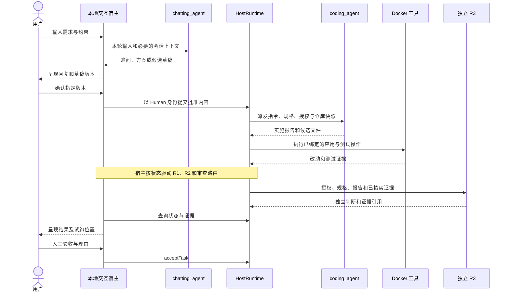

# CCCP 本地交互宿主架构设计与开发计划书

**评审草案 · 2026-11-22 · 实现基线 v0.2.0 · 协议基线 CCCP 1.0**

## 1. 交付目标

让一位用户从终端输入自己的需求，与讨论 Agent 澄清目标，亲手批准一份可执行的任务，并在看到实际改动、测试结果和独立审查意见后作出验收决定。首次试用的成功标志是用户能独立回答三个问题：“我授权了什么？它实际做了什么？我凭什么接受这次改动？”

建议首版采用 Windows 本机、单用户、一个受管理的示例 Git 仓库和一组固定工具。**固定的是仓库、可写范围与可运行的工具，用户现场决定任务内容。** 示例可用一个日期校验 CLI。用户可以要求它正确识别 2 月 30 日，也可以在同一授权范围内提出另一个可验证的日期问题。实际交付物在独立 worktree 中供用户运行和查看。合并回源分支属于后续显式操作。

### 现有能力与交付差距

| 用户环节 | v0.2.0 基线 | 本次交付 |
|---|---|---|
| 提需求、追问 | 测试脚本提供固定指令。Runtime 的 `deliberate` 用于已创建任务中的候选方案，当前路由指向实施端 | 建立任务创建前的多轮会话，允许修改需求、比较方案、生成草稿 |
| 批准与交接 | `startTask` 以已认证 Human 身份接收 Intent、Decision、Specification、Delegation、Profile | 将用户看到的草稿版本和实际提交的五个对象绑定 |
| 改代码、验证 | Codex 产生候选，Docker 在 worktree 应用修改、执行测试，Runtime 存储证据 | 从测试装配提取可运行的宿主，替换固定提示词、固定文件内容和固定通过断言 |
| 审查与验收 | 真实用例中的 R1/R2 判断由脚本构造，R3 来自独立模型。默认用例到待验收后清理目录 | 对本次实际要求完成 R1/R2，显示真实 R3、证据和产物位置，支持返回同一任务验收 |

基线依据见[协议设计](../CCCP%20v1.0%20Design%20Guide.md)、[真实宿主装配](../tests/fixtures/real-agent-host.mjs)、[端到端用例](../tests/e2e-real-agents.test.mjs)和[历史验证结果](M4_E2E_REPORT.md)。

## 2. 从用户输入到人工验收

以下是拟实现的交互示例。命令名与界面文案供评审。

1. 用户运行 `npm run chat`，终端显示示例仓库、基准提交和本次选用的讨论、实施、审查模型。环境预检分别指出当前可用的功能。例如 Docker 未启动时，可以讨论草稿并看到实施所缺的条件。
2. 用户输入“日期工具接受了 2 月 30 日”。讨论 Agent 追问预期行为。用户补充“保持已有错误提示和退出码，合法闰日仍应通过”。用户输入 `/draft`，得到带版本号的草稿，看到目标、方案、允许路径、禁止操作、逐条验收条件和实际测试命令。可以继续聊天修改。
3. 用户输入 `/approve 2` 批准屏幕上展示的第 2 版。宿主记录批准，显示任务 ID，启动实施。用户看到实施、应用、测试、审查各阶段的结果。遇到需扩大授权的提议时，显示受影响的文件、原因和等待谁处理。
4. 终端展示改动文件、关键差异、每条要求对应的测试和审查结论，并给出实际 worktree 路径及试跑命令。用户可先退出，稍后用 `npm run chat -- --resume <会话ID>` 返回。输入 `/accept <理由>` 才写入人工验收。暂缓时保留待验收状态。

## 3. 架构与通信

| 组件 | 负责什么 | 接口与存储 |
|---|---|---|
| 终端与会话控制 | 解析用户输入、呈现草稿、展示进度、接受明确的控制命令 | 本机标准输入输出。只有用户输入通道能发起批准、停止或验收 |
| 讨论适配器 | 处理多轮问答，按需生成结构化草稿 | 从宿主接收选定的上下文，用厂商 HTTPS API 调用讨论模型，返回文本或结构化数据 |
| 草稿与任务交接 | 维护修订、校验字段和范围、把批准映射为一次 Runtime 请求 | 本地 SQLite 保存会话和交接记录。与 Runtime 的持久化表按职责区分 |
| 任务驱动程序 | 读取 Runtime 当前状态，调用发现、规划、实施、工具和审查接口，处理等待与失败 | 与 Runtime 进程内通信。每次采用 Runtime 返回的状态版本，控制器决定合法迁移 |
| 执行与证据 | 复用 Codex App Server、Git worktree、Docker、EvidenceStore、Reviewer 与恢复机制 | Codex 端使用 stdio。R3 按显式配置走独立 App Server 或已支持的审查 API |

建议新增独立交互入口和讨论适配器，复用现有 `src/runtime/`。普通聊天轮次属于宿主会话，跨入执行时使用现有协议对象。先以进程内调用完成首版；以后接入已有聊天产品时，可用 MCP 在外层提供草稿提交和任务查询，复用同一套人工批准接口。[Runtime 规范](HOST_RUNTIME_SPEC.md) · [Bridge 边界](BRIDGE_API_SPEC.md)

### 模型接入与选择

| 配置角色 | 首版建议 | 调用时传什么、取回什么 |
|---|---|---|
| `chatting_agent` | 独立选择 provider、model 和凭据来源。首个 adapter 拟用 OpenAI Responses API | 输入本轮对话、必要历史和可用的项目摘要；返回澄清问题、可读答复或草稿。可流式显示文本，只有完整且校验成功的草稿可供确认 |
| `coding_agent` | 复用 `CodexAgentProvider` 和本机 Codex 登录，独立设置实施模型 | 宿主按获批规格派发实施指令，Codex 在只读工作区返回 `file_changes`，宿主检查路径和工具绑定后应用 |
| `reviewer` | 显式选择独立 ChatGPT 会话、OpenAI API 或已有的 DeepSeek 审查适配器。首轮真人试用优先复用已有通过记录的 ChatGPT 路径 | 输入本次冻结的授权和证据，输出结构化 ReviewResult；记录 provider、实际返回的模型标识或本机默认标记、run ID |

配置文件仅记录角色、后端、模型和环境变量名，凭据由宿主读取。启动时回显各角色的生效配置和缺失项。新宿主按角色显式选择后端，避免测试装配中“环境里有某个 key 就切换 reviewer”的行为影响用户。讨论端采用 OpenAI API 时需要可用的 API 凭据；现有 Codex 登录用于实施和独立 App Server 审查。讨论模型由适配器负责续接会话，宿主保留可读历史、草稿和确认记录。后续接第二家时可验证 DeepSeek 随请求传历史的方式。[OpenAI 会话文档](https://developers.openai.com/api/docs/guides/conversation-state) · [结构化输出](https://developers.openai.com/api/docs/guides/structured-outputs) · [Codex App Server](https://github.com/openai/codex/blob/main/codex-rs/app-server/README.md) · [DeepSeek 多轮对话](https://api-docs.deepseek.com/guides/multi_round_chat/)

## 4. 批准、执行与恢复契约

**草稿。** 讨论端提供目标、方案、约束、非目标、验收条件和建议范围。宿主生成 ID，关联源仓库、固定基准提交和已注册的 worktree，并从本地工具配置选出实际可用的操作。生成的 Specification 保留 Decision 里的约束与非目标；Delegation 明确允许路径与操作；Profile 指向已注册的工作目录。终端展示最终生效的字段，核对通过后保存不可变版本。用户编辑任一执行相关字段，版本递增。

**确认。** 本地用户控制通道持有受任务范围限制的 Human 会话，Agent 请求用各自身份发送。批准记录关联会话 ID、草稿版本、最终五个对象的内容摘要、仓库基线、操作者与时间。提交前检查版本和基线，过期则重新展示。采用现有 Directed 入口接收用户已经选定的方案；宿主保存前面的讨论和备选方案，可按 ID 追溯。聊天文本或模型输出中即使出现 `/approve` 也只作为文本显示。[决策生命周期](../src/decision.mjs) · [Runtime 创建与认证](../src/runtime/host-runtime.mjs)

**幂等与掉线。** 在一次本地事务中冻结批准记录，并保存待提交的原始 Runtime 请求（凭据以本地身份引用表示）、稳定的任务 ID 与幂等键。提交成功后记回执。若“任务已创建、界面没收到回执”，用同一任务 ID 查持久状态，核对批准摘要；只在已知可重试时使用相同请求上下文和幂等键。发现未决外部执行或未知副作用，展示 `RECONCILIATION_REQUIRED` 和对应操作，沿用 Runtime 对账规则。重开终端时先恢复既有任务并读取证据，避免再次写文件或重跑已完成操作。[持久化规范](PERSISTENCE_SPEC.md) · [Agent 恢复边界](AGENT_PROVIDER_SPEC.md)

**审查。** 示例 Profile 同时设置 `require_r3=true` 和 `human_acceptance=true`，确保走到独立 R3 后的人工验收。R1 核对应用与测试结果；R2 将实际规格逐条映射到当前证据。可复用 Runtime 的 R1/R2 审查派发能力。证据不足的条目标为未验证并交给控制器处理。工具或模型超时应显示失败发生在哪一步。R3 取得冻结的真实差异和测试证据后独立给出判断。[审查路由](../src/lifecycle.mjs) · [证据与 Review](AGENT_PROVIDER_SPEC.md)

**越界与产物。** 若原授权内的实现有误，沿用现有修订预算。若需要改公共 API 或扩展写入路径，停止实施，返回提议及原因。首版演示到“用户可看懂提议，旧授权无法继续”即可。若要在原任务内接受新授权，需另行接通控制器的 `adoptDecision` / `replaceDelegation` 与持久化重放；当前 `resumeTask` 不具备扩权语义。用户验收后，保存证据和 worktree 位置；关闭界面或暂缓验收都应保留查看入口。[执行控制器](../src/lifecycle.mjs) · [重放日志](../src/runtime/controller-journal.mjs)

## 5. 开发顺序与验收

按一名熟悉仓库的开发者、有可用的模型账号和本地 Docker 环境估算。工时包含针对性回归和一次真人试用；模型额度、外部服务故障及等待用户试用的时间另计。各阶段为本提案的工作包，独立于既有 M0–M5 编号。

| 工作包 | 依赖与工时 | 可评审交付物 | 通过条件 |
|---|---|---|---|
| A · 终端与讨论 | 起点，1–2 人日 | CLI、角色配置与预检、一个真实讨论适配器、本地会话和版本化草稿 | 用户现场提需求、追问、修改条件；重开能找到原草稿；此时实施调用数为零 |
| B · 人工批准与任务创建 | A，1–2 人日 | 草稿到五个协议对象的映射、真实用户确认、持久交接与任务查询 | 审批第 2 版时第 1 版失效；重复确认和回执丢失均只得到同一任务；基线变化需重新确认 |
| C · 通用化演示执行 | B，2–3 人日 | 一个示例项目、固定工具绑定、按实际规格生成实施请求、R1/R2 证据映射、独立 R3、进度和差异呈现 | 对同一示例仓库分别运行两条不同的用户需求，修改和证据随要求变化；失败测试或失效证据无法流入成功验收 |
| D · 等待、恢复和真人试用 | C，1–2 人日 | 暂缓、恢复与明确验收操作，阻塞展示、用户指南修订、试用记录 | 用户独立完成下面的试用；恢复后能找到同一任务和 worktree；审计可关联批准版本、执行证据和验收理由 |

**预计 5–9 人日。** 首个能与模型讨论真实需求并看到草稿的原型对应 A，预计 1–2 人日。此前针对单一预设任务的 2–4 日粗估覆盖的范围较小。本计划额外计入真实多轮接入、版本化交接、依需求执行、恢复和独立试用。建议先完成 A 和 B，拿一份用户亲手批准的真实草稿验证结构与交互，再投入执行通路。

### 首次真人试用脚本

1. 在新会话现场提出一个日期处理问题，补充一条要求，再生成新草稿。用户指出允许改哪里、要通过哪些样例。
2. 批准最新草稿。在终端确认任务 ID，看到实际使用的模型、当前步骤和写入位置。在 worktree 用一个无效输入和一个合法输入试跑。
3. 到待验收时退出并重开。检查先前任务及证据仍可读取，批准、应用操作和人工验收均可按任务 ID 回溯。用户给出自己的验收理由，或选择暂缓。
4. 另起一次边界试验，提出超出该示例 Profile 的要求，记录系统显示的阻塞原因、用户能做的选择和工作区实际变化。开发者同时用隔离用例验证模型断流、重复确认、失败测试、旧证据和进程中断。

交付证据包括一份脱敏的会话与授权摘要、任务审计、差异和测试记录，并记录用户在哪一步需要帮助。只要批准仍由测试代填、R2 仍固定返回通过，或用户需要开发者代查数据库才能决定验收，该里程碑就继续保持待验收。

## 6. 评审决策

阶段 C 的日期示例使用一把 DeepSeek key 完成讨论、实施和审查。实施适配器只向 DeepSeek 发送获批规格和示例里的两个文件。模型返回候选文件，写入和测试仍由带固定绑定的 Docker 执行。R2 与 R3 分开调用并记录，R3 使用独立审查主体。用户用 `/run` 显式开始，以 `/task` 查询最终状态和证据。[日期示例用法](USER_GUIDE.md#运行自己的日期示例需求)

阶段 D 将暂缓和验收纳入 Runtime 审计。重开时先加载同一任务；验收前复核基准提交和 R3 证据，之后把验收理由和证据引用一起保存。存在未对账的外部运行时，任务详情显示对应的操作 ID。[试用记录](INTERACTIVE_HOST_TRIAL.md)

本提案建议优先确认三项产品选择：终端作为首次入口，讨论端首先接 OpenAI Responses API，示例仓库限定工具范围并接受用户现场提出的任务。如果首个验收目标改为“必须在现有 ChatGPT 对话内操作”，应提前安排 MCP 接入、用户身份映射和本地宿主可达性验证，并重新估算入口交付。若目标改为支持任意业务仓库，应先补项目配置、工具绑定和验证命令的接入流程。两个方向均可沿用同一套草稿、授权与验收接口。[MCP 架构](https://modelcontextprotocol.io/docs/learn/architecture)
